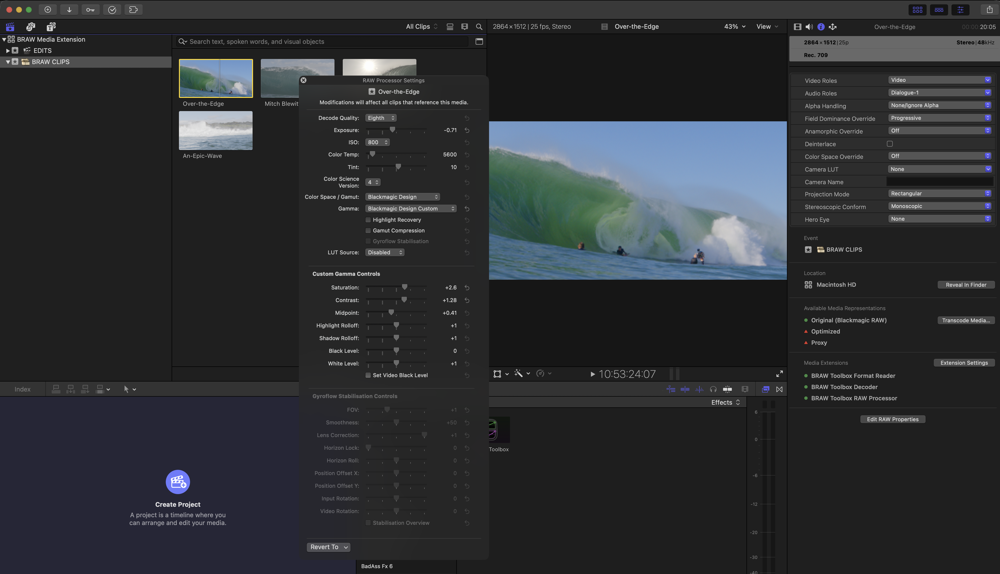
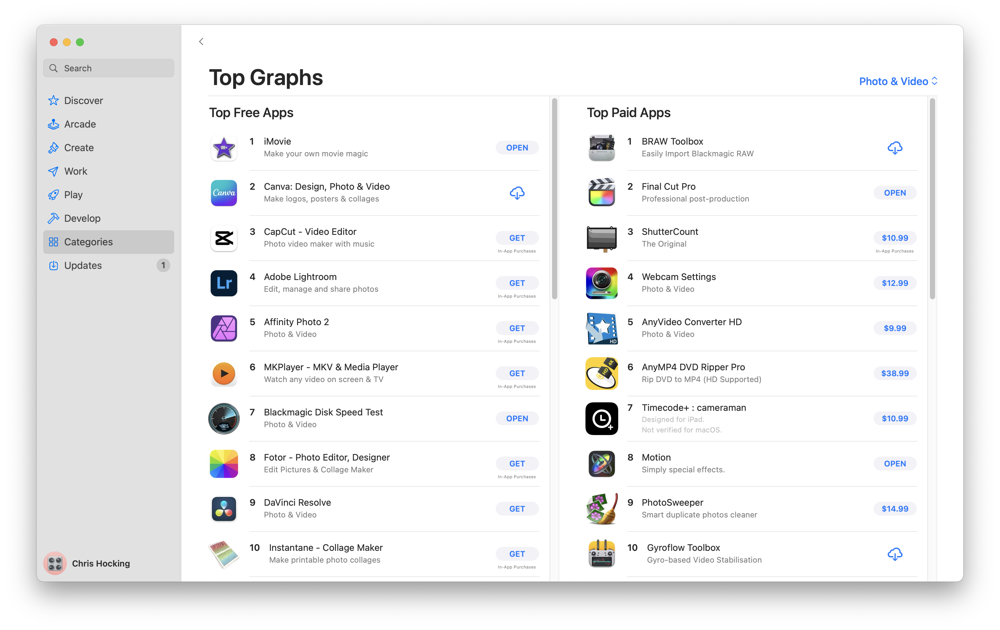

# BRAW Toolbox

**BRAW Toolbox** allows you to work with **Blackmagic RAW** files natively and seamlessly everywhere on your Mac!

!!!success
You can [buy now](/buy) on the **Mac App Store**!
!!!

It has a **Media Extension** allowing you to read Blackmagic RAW files directly within QuickTime Player, Final Cut Pro, Compressor and every other application that supports macOS Media Extensions.

If you're working with Final Cut Pro, you can simply drag Blackmagic RAW clips from Finder to your timeline or browser - it's that easy. 🥳

You get full access to all the RAW controls via Final Cut Pro's **Edit RAW Properties** in the Info Inspector - nothing is baked in.

You can even import Blackmagic URSA Cine Immersive clips and then stream them to your [Vision Pro](/immersive/)!

**_No more waiting. No more transcoding. No more massive ProRes files._**

Save hours of time, and terabytes of storage!

Released in **December 2022**, and [constantly updated and improved](/release-notes/), BRAW Toolbox is now loved and trusted by over **4.40K** editors from all around the world!

It's been used on **feature films**, **televisions series**, **music videos** and **high-end television commercials**.

---

## Number One

Thanks to everyone who helped us reach **#1** in the **Photo & Video** category on the Mac App Store at various places around the world during our first week! :icon-trophy:

Since then, BRAW Toolbox has continued to reach the top lists on a regular basis! Thanks for your continued support!

