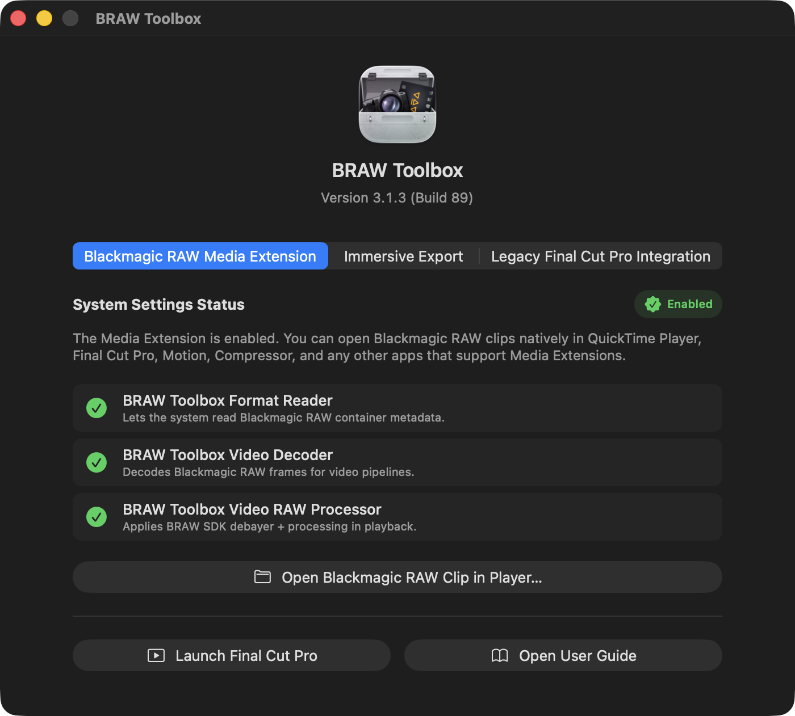
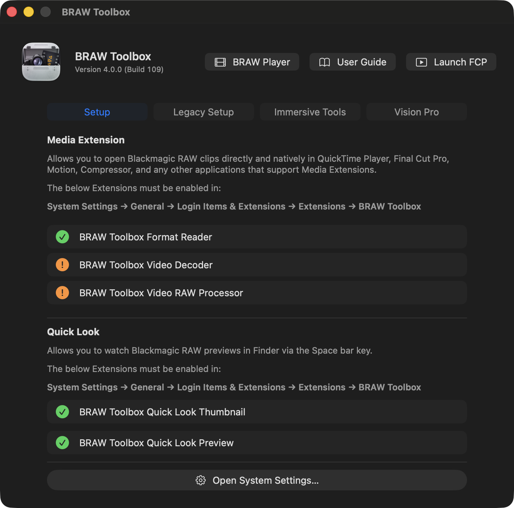
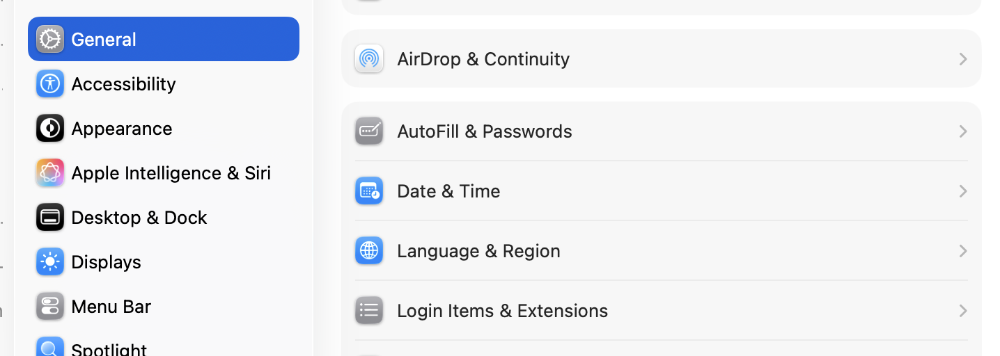
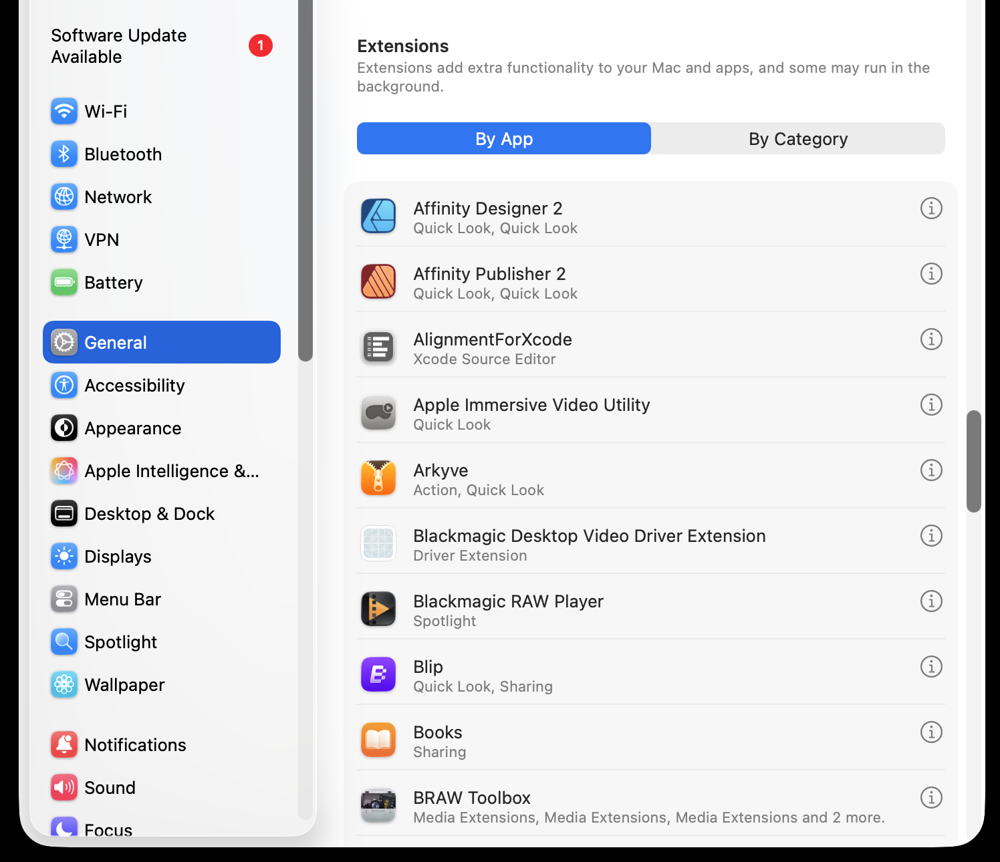
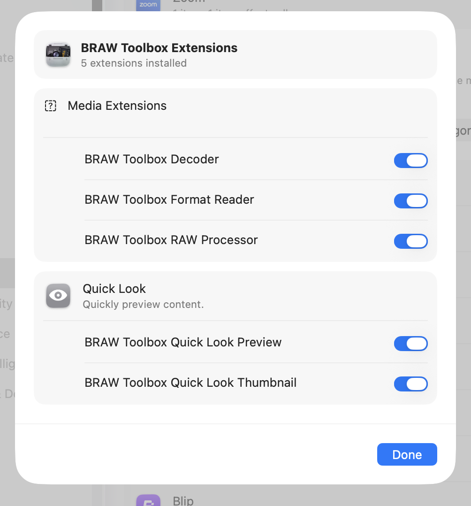
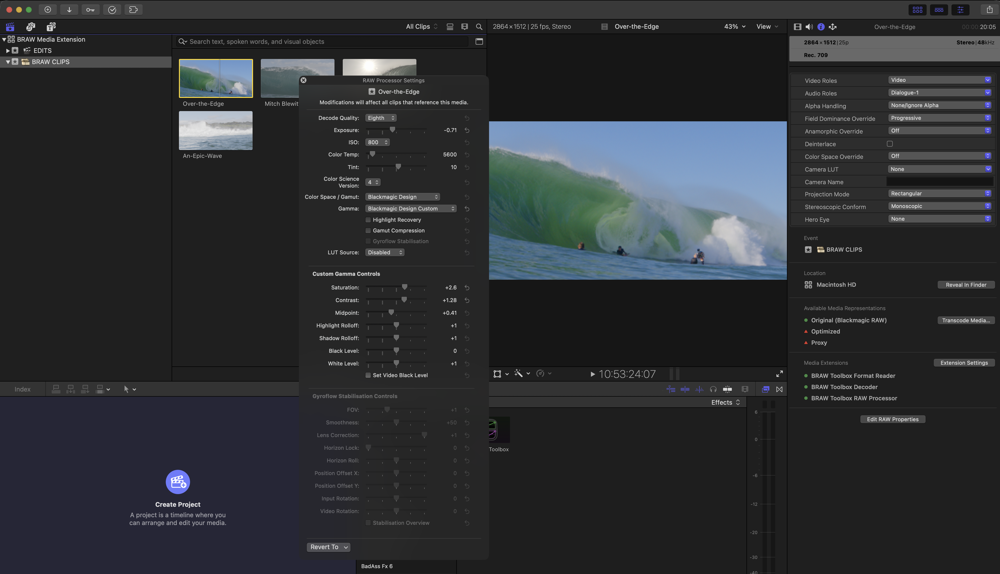
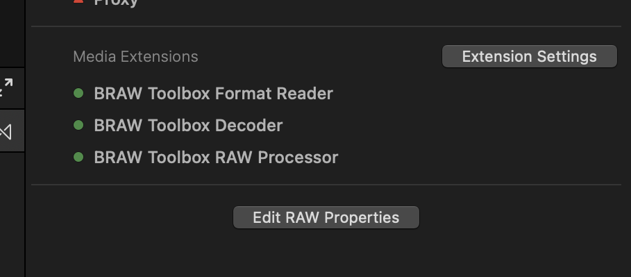

# Installation

**BRAW Toolbox** contains a **Media Extension** allowing you to play back Blackmagic RAW in QuickTime Player, Final Cut Pro, Compressor and any other macOS applications that support Media Extensions.

The Media Extension **REPLACES** the previous Workflow Extension and FxPlug Motion Templates - these only still exist for legacy projects and specific workflows.

For **MOST** users, the Media Extension will be what you use to access Blackmagic RAW in Final Cut Pro.

When you first install **BRAW Toolbox**, the Media Extensions are **off by default** - you need to enable them in **System Settings**.

Open **System Settings** then in the **General** tab, select **Login Items & Extensions**.

Scroll all the way down to **Extensions**, select **By App**.

Find **BRAW Toolbox** in the list, and click the Info icon next to it.

You should then enable the **three** Media Extensions, and two Quick Look Extensions.

Once enabled, you can import Blackmagic RAW files natively into Final Cut Pro, with full RAW controls.

You can find the RAW controls at the bottom of the **Metadata Inspector** with the **Edit RAW Properties** button.

