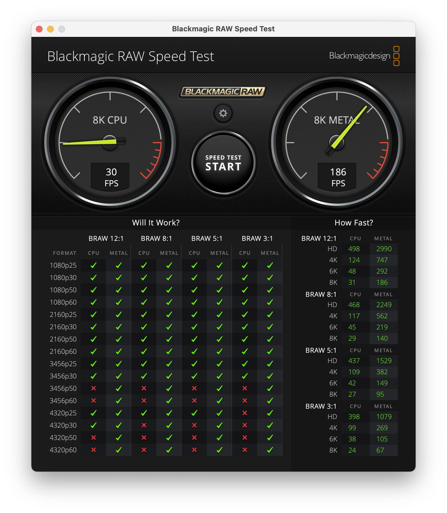

# System Requirements

BRAW Toolbox on **Mac** requires **macOS Sequoia 15** (or later).

It works best on the latest Apple Silicon Mac's, however Intel is also supported.

BRAW Toolbox on **Vision Pro** requires **visionOS 26** (or later).

Before you purchase, you should make sure that your system has a fast enough GPU and hard drive to play back Blackmagic RAW files.

You can use Blackmagic's free [Blackmagic RAW Speed Test](https://apps.apple.com/app/blackmagic-raw-speed-test/id1466185689) and [Blackmagic Disk Speed Test](https://apps.apple.com/app/blackmagic-disk-speed-test/id425264550) tools to ensure your system is fast enough for the footage you want to work with.

You can also use Blackmagic's free [Blackmagic RAW Player](https://apps.apple.com/app/blackmagic-raw-player/id1435415804) to test playing back Blackmagic RAW files on your system.

