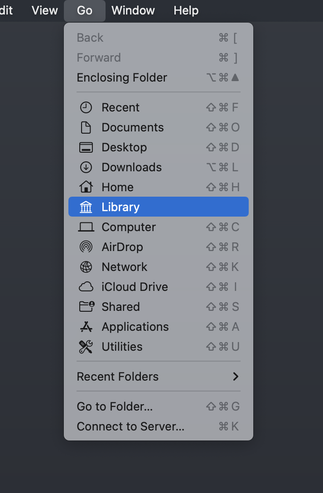
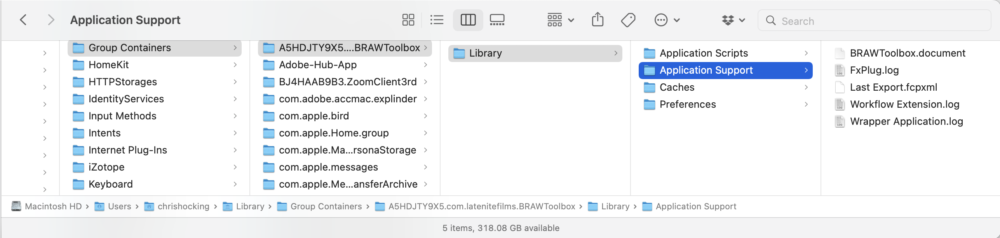
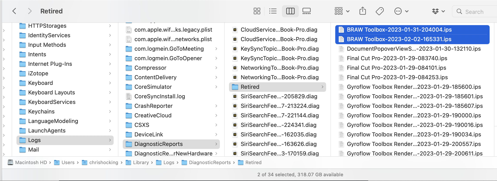
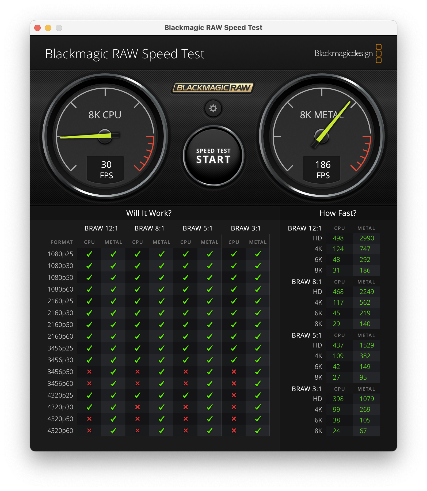
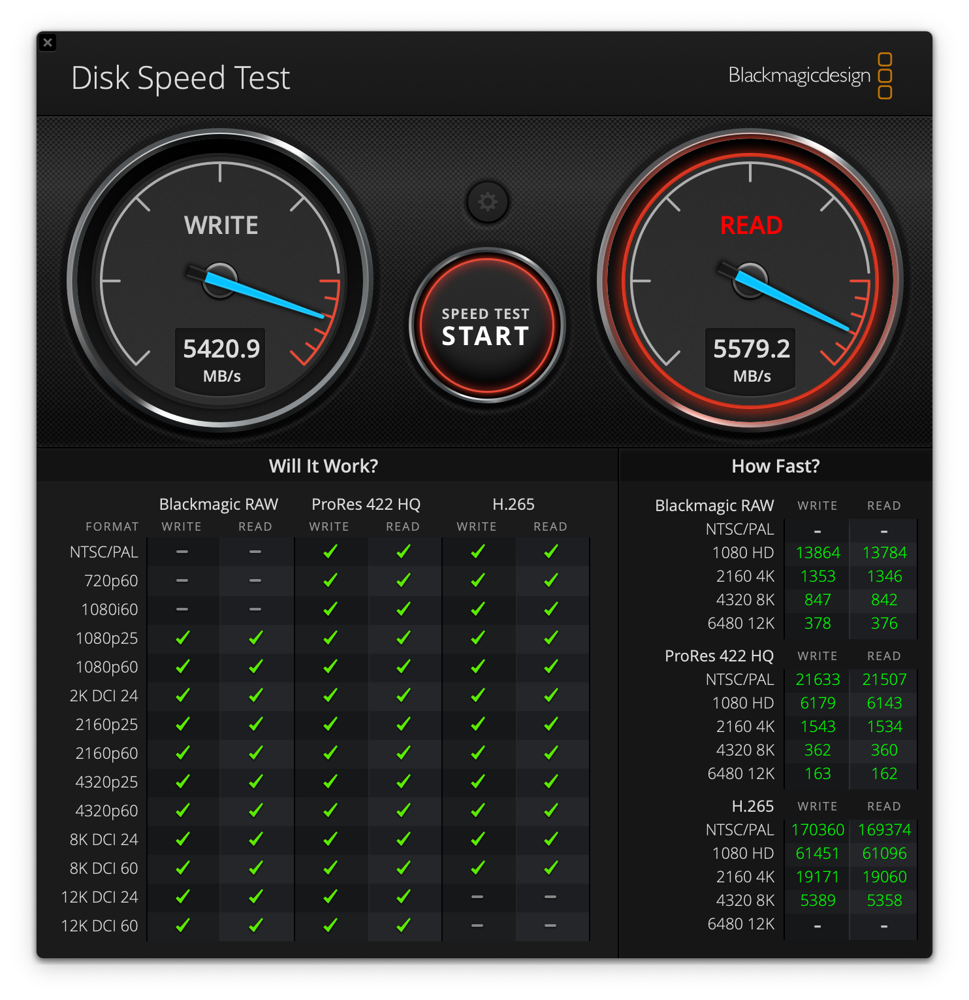
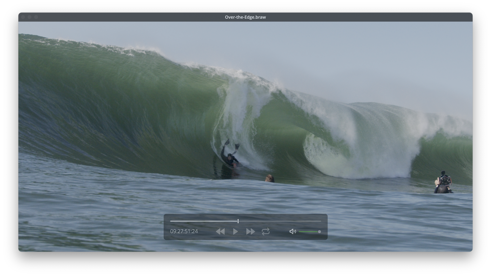

# Troubleshooting

### I've run into a bug. Where can I find the log files?

You can access your User Library, by clicking on your **Desktop**, then holding down **OPTION** as you click the **Go** menu item in Finder. A **Library** option will appear:



Once you have your User Library open, you can find the log files here:

`/Users/YOUR-USER-NAME/Library/Group Containers/A5HDJTY9X5.com.latenitefilms.BRAWToolbox/Library/Application Support/`

You can also copy the below path, press **COMMAND+SHIFT+G** from Finder (or via the **Go > Go to Folder...** menubar item), and paste in that path into the **Go to Folder** popup:

```
~/Library/Group Containers/A5HDJTY9X5.com.latenitefilms.BRAWToolbox/Library/Application Support/
```

Please create a ZIP file of this entire **Application Support** folder (by right-clicking and selecting the **Compress** menu item), so that we can review all of these log files:



You can find any crash reports here:

`/Users/YOUR-USER-NAME/Library/Logs/DiagnosticReports`

Again, you can also copy the below path, press **COMMAND+SHIFT+G** from Finder (or via the **Go > Go to Folder...** menubar item), and paste in that path into the **Go to Folder** popup:

```
~/Library/Logs/DiagnosticReports
```

Any crashes related to BRAW Toolbox will have **BRAW Toolbox** at the start of the filename.

There might also be crash logs in the **Retired** sub-folder (these are crash logs that have already been sent to Apple):

`/Users/YOUR-USER-NAME/Library/Logs/DiagnosticReports/Retired`



Again, please ZIP up all of these individual crash logs, so that we can review them all.

You [post an issue](https://github.com/latenitefilms/brawtoolbox/issues) with these files in a ZIP, and we'll try and resolve your specific problem.

---

### Is my Mac fast enough to play BRAW files?

You can use the free **Blackmagic RAW Speed Test** to check if your system's GPU is fast enough to play BRAW files.

> [:icon-desktop-download: You can download on the Mac App Store here.](https://apps.apple.com/us/app/blackmagic-raw-speed-test/id1466185689?mt=12)



You can use the free **Blackmagic Disk Speed Test** to check if your hard drive is fast enough to keep up with BRAW files.

> [You can download on the Mac App Store here.](https://apps.apple.com/au/app/blackmagic-disk-speed-test/id425264550?mt=12)



You can use the free **Blackmagic RAW Player** to see how your system performs playing back your BRAW files.

> [You can download on the Mac App Store here.](https://apps.apple.com/us/app/blackmagic-raw-player/id1435415804?mt=12)



---

### Why can't I adjust the Custom Gamma Controls?

You can only adjust the Custom Gamma Controls if you select the **Blackmagic Design Custom** Gamma option.

Custom Gamma Controls are also not supported by Blackmagic Generation 6 Colour Science.