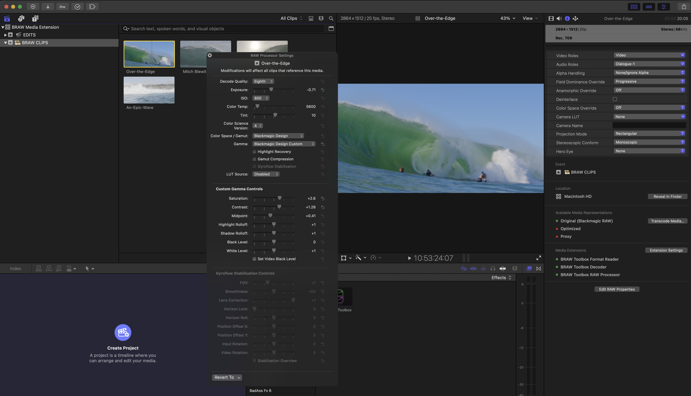
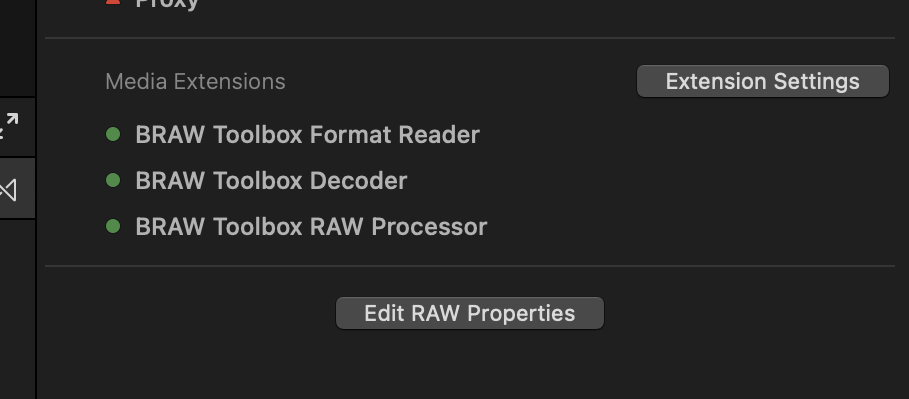
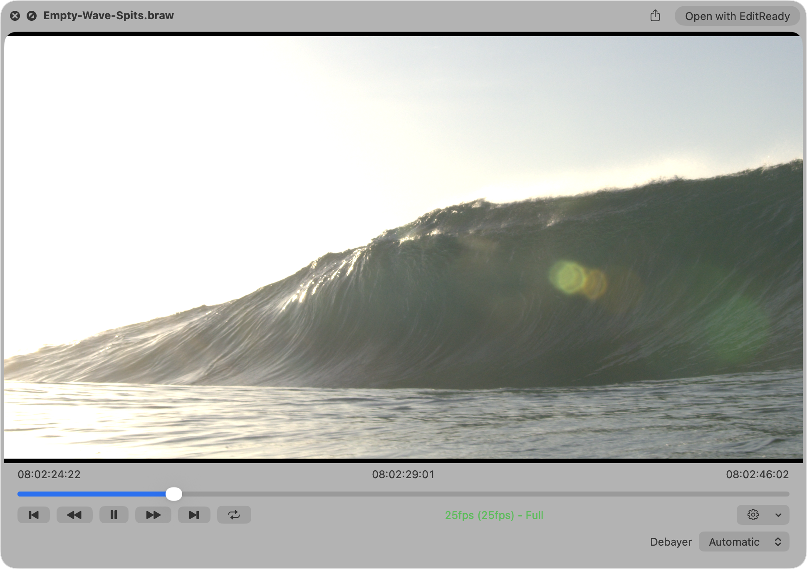
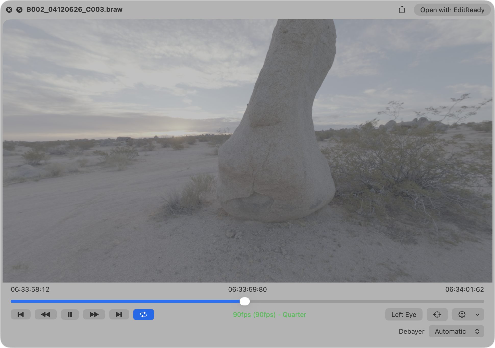
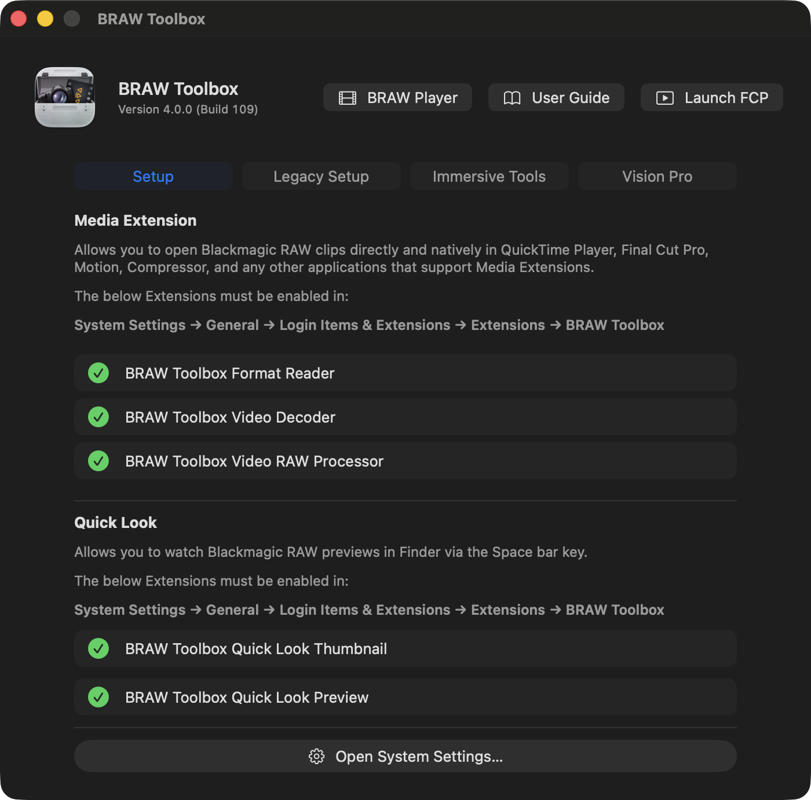
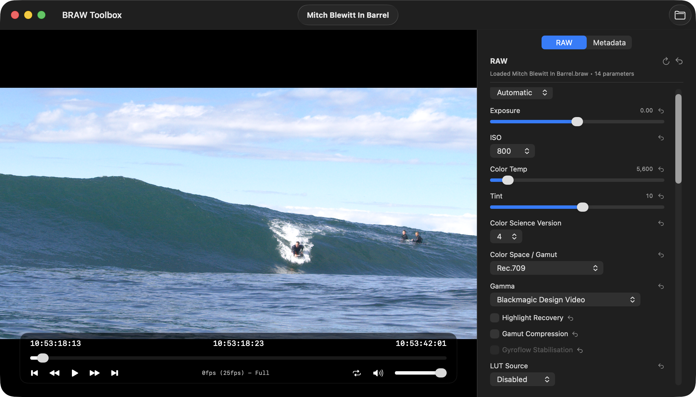

# How To Use

After [installing](/installation), you can simply drag-and-drop Blackmagic RAW files directly into Final Cut Pro!

You can find the RAW controls at the bottom of the **Metadata Inspector** with the **Edit RAW Properties** button.

---

## Quick Look

Once Quick Look is enabled in System Settings you can simply use the Space bar key in Finder to preview Blackmagic RAW files.

You can even preview Immersive clips.

---

## BRAW Player

The BRAW Toolbox application also has a built-in Blackmagic RAW player.

When you launch **BRAW Toolbox** from your `/Applications` folder, click **BRAW Player** in the top-right corner.

You then have a player with full RAW controls and full metadata viewing:

You can even stream Immersive clips to the BRAW Toolbox Vision Pro app.
